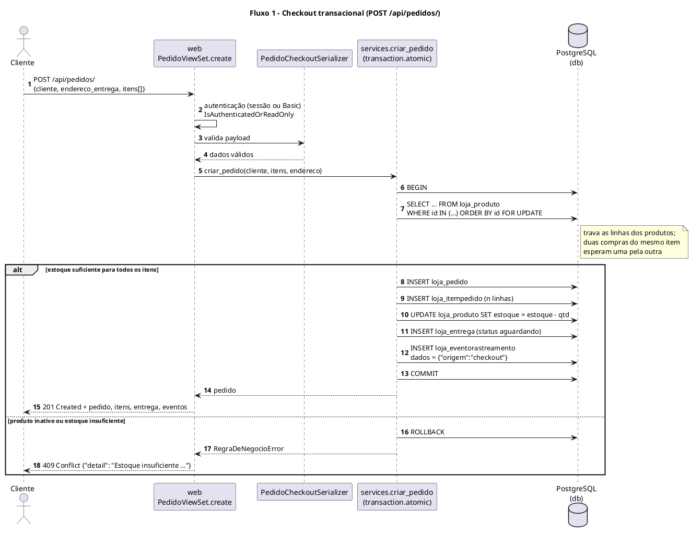
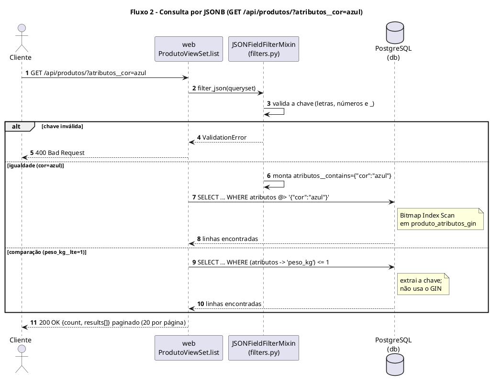
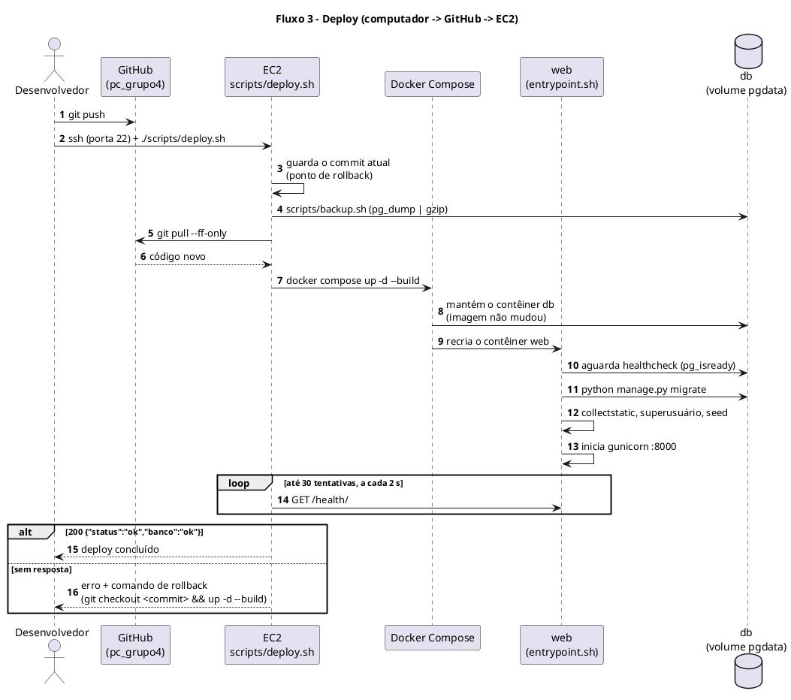

| id    | seq_com |
| :---- | :------ |
| title | Sequência e Comunicação |

# Sequência e Comunicação

**Projeto:** Plataforma de E-commerce com Logística Last-Mile — Grupo IV (Ricardo França, Antonio Sinhorelli, Caio Araujo)
**Escopo:** a solução implantada na AP2 — API Django REST (projeto `lastmile`, app `loja`) e PostgreSQL 16 em Docker Compose numa instância EC2.

| Versão | Data | Autor | Descrição |
| :--- | :--- | :--- | :--- |
| 1.0 | 12/11/2026 | Grupo IV | Fluxos críticos da solução implantada, canais de comunicação e matriz de rastreamento. |

---

## 1. Objetivo

Este documento mostra, em diagramas de sequência, como os componentes implantados conversam nos três fluxos críticos da AP2 — **criação de registro transacional (checkout)**, **consulta por JSONB** e **deploy** — e liga cada requisito ao caso de uso, ao componente que o implementa, ao teste automatizado e à evidência coletada na EC2.

## 2. Participantes

| Participante | Onde roda | Responsabilidade |
| :--- | :--- | :--- |
| Cliente / app do entregador | Navegador ou app, na internet | Chama a API por HTTP na porta 8000 |
| Security Group `lastmile-ap2-sg` | AWS | Libera só 22 (SSH) e 8000 (API); 5432 fechada |
| `web` (gunicorn + Django + DRF) | Contêiner na EC2 | Recebe as requisições, valida, aplica regras de negócio |
| `services.py` | Dentro do `web` | Regras transacionais (`criar_pedido`, `cancelar_pedido`, `registrar_evento`) |
| `filters.py` | Dentro do `web` | Traduz filtros de URL em consultas JSONB |
| `db` (PostgreSQL 16) | Contêiner na EC2, volume `pgdata` | Tabelas relacionais + JSONB com índices GIN |
| GitHub | Nuvem | Repositório do código (`pc_grupo4`) |
| Desenvolvedor | Computador do grupo | Altera o código e faz o deploy por SSH |

## 3. Fluxo 1 — Criação de registro transacional (checkout)

`POST /api/pedidos/` cria pedido, itens, entrega e o primeiro evento de rastreamento e baixa o estoque, **tudo na mesma transação**. Se qualquer passo falhar, nada é gravado.

**Evidência na EC2:** o pedido de 2 unidades do ELE-001 retornou 201 e o estoque passou de 37 para 35; o pedido de 99 999 unidades retornou 409 e o estoque continuou em 35 ([10_checkout_ok](../assets/evidencias/10_checkout_ok.png), [11_checkout_rollback](../assets/evidencias/11_checkout_rollback.png)).

## 4. Fluxo 2 — Consulta por JSONB

`GET /api/produtos/?atributos__cor=azul` filtra por uma chave dentro do campo JSONB. Igualdade vira o operador de contenção `@>`, que é o que o índice GIN acelera.

**Medição:** em 180 mil eventos de rastreamento, a busca por uma ocorrência rara levou **0,36 ms** com o índice GIN (`@>`) e **16,8 ms** sem ele (varredura sequencial) — detalhes em [Dimensionamento de Banco de Dados](dimrbd.md). **Evidência na EC2:** o filtro `?atributos__cor=azul` devolveu os 2 produtos azuis dos 8 do catálogo ([06_api_filtro_json](../assets/evidencias/06_api_filtro_json.png)).

## 5. Fluxo 3 — Deploy

Atualização da aplicação na EC2 com a estratégia *recreate* descrita em [Estratégias de Deploy](../Transicao/ativ_deploy.md).

**Evidência na EC2:** contêineres `web` e `db` saudáveis e log do `web` com migrations, `collectstatic` e gunicorn ([01_docker_ps](../assets/evidencias/01_docker_ps.png), [02_compose_logs](../assets/evidencias/02_compose_logs.png)); dados preservados após `down`/`up` ([12](../assets/evidencias/12_persist_antes.png), [13](../assets/evidencias/13_persist_down_up.png), [14](../assets/evidencias/14_persist_depois.png)).

## 6. Canais de comunicação

| De → Para | Protocolo / porta | Formato | Proteção |
| :--- | :--- | :--- | :--- |
| Cliente → `web` | HTTP, 8000 | JSON (REST) | Security Group; escrita exige autenticação |
| `web` → `db` | TCP, 5432 na rede interna do Compose | SQL (psycopg 3) | Porta não publicada; senha no `.env` |
| Desenvolvedor → EC2 | SSH, 22 | Terminal | Chave privada; SG libera só o IP do grupo |
| EC2 → GitHub | HTTPS, 443 | Git | Saída liberada; repositório sem segredos |
| `db` → volume `pgdata` | Disco local (EBS gp3 criptografado) | Arquivos do PostgreSQL | Persiste a `down`/`up`; backup diário por `pg_dump` |

## 7. Matriz de rastreamento

Requisitos de [Requisitos Suplementares](../Iniciacao/rs.md) §15, casos de uso de [Casos de Uso Arquiteturais](cua.md) §7, testes de `src/loja/tests.py` e evidências em `docs/assets/evidencias/`.

| Requisito | Caso de uso | Fluxo | Componente | Teste automatizado | Evidência na EC2 |
| :--- | :--- | :--- | :--- | :--- | :--- |
| RNF-AP2-05 Integridade transacional | UC-AP2-02 Finalizar compra | 1 | `services.criar_pedido`, `PedidoViewSet` | `test_checkout_grava_varias_tabelas_e_baixa_estoque`, `test_estoque_insuficiente_faz_rollback_completo`, `test_falha_no_meio_da_transacao_desfaz_tudo` | 10, 11 |
| RNF-AP2-05 Integridade transacional | UC-AP2-03 Cancelar pedido | 1 | `services.cancelar_pedido` | `test_cancelar_devolve_estoque` | — |
| RNF-AP2-06 Consulta JSON com GIN | UC-AP2-01 Consultar catálogo | 2 | `filters.py`, `Produto.atributos` + `produto_atributos_gin` | `test_filtro_por_campo_json`, `test_filtro_igualdade_usa_operador_de_contencao_do_gin`, `test_indices_gin_existem_no_banco` | 03, 06 |
| RNF-AP2-06 Consulta JSON com GIN | UC-AP2-04 Registrar evento | 2 | `services.registrar_evento`, `EventoRastreamento.dados` + `evento_dados_gin` | `test_registrar_evento_atualiza_entrega_e_pedido`, `test_filtro_json_em_eventos` | — |
| RNF-AP2-04 Segredos fora do Git | UC-AP2-05 Administrar dados | 3 | `settings.py`, `.env.example`, `criar_superusuario` | `test_criar_superusuario_via_ambiente_e_idempotente`, `test_admin_funcional_para_superusuario` | 08, 09 |
| RNF-AP2-01 Disponibilidade | UC-AP2-06 Verificar saúde | 3 | `views.health`, healthchecks do `docker-compose.yml` | `test_health` | 01, 07 |
| RNF-AP2-02 Persistência | UC-AP2-02 Finalizar compra | 3 | volume `pgdata` | — (teste manual) | 12, 13, 14 |
| RNF-AP2-03 Isolamento do banco | — | 3 | `docker-compose.yml` (db sem `ports`), `lastmile-ap2-sg` | — (inspeção) | 01, 17 |
| RNF-AP2-07 Recuperação | — | 3 | `scripts/backup.sh` | restauração testada (ver [dimrbd](dimrbd.md) §13.5) | — |
| RNF-AP2-08 Deploy reproduzível | — | 3 | `scripts/deploy.sh`, `Dockerfile`, `entrypoint.sh` | — | 02 |
| RNF-AP2-09 Qualidade | todos | 1, 2, 3 | `src/loja/tests.py` | 22 testes, todos passando | — |

Legenda das evidências: 01 `docker ps` · 02 logs do `web` · 03 `\d loja_produto` · 06 filtro JSONB · 07 `/health/` · 08 e 09 Admin · 10 e 11 checkout · 12 a 14 persistência · 17 regras do Security Group.
