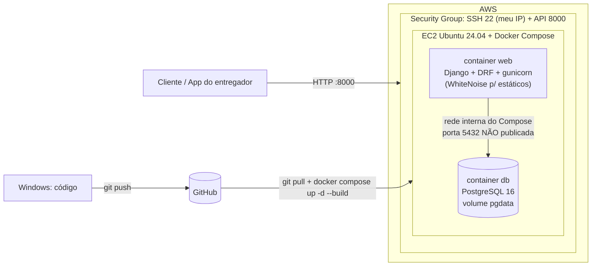
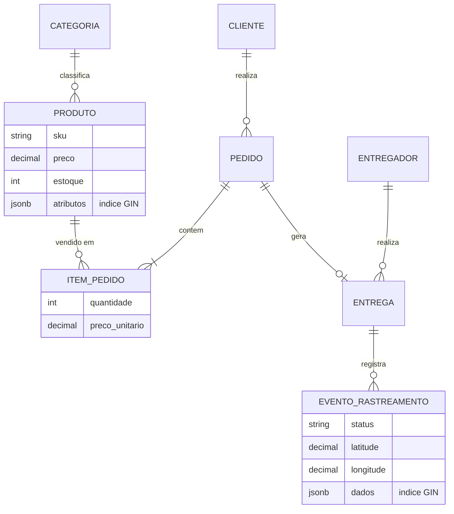

# Plataforma de E-commerce com Logística Last-Mile — AP2

**Disciplina:** Projeto de Cloud (PC) — Ibmec · **Turma:** PC_ADS_26.2_8001 · **Grupo IV**
**Integrantes:** Ricardo França, Antonio Sinhorelli, Caio Araujo

API Django REST **multimodelo** (PostgreSQL relacional + documento/JSONB) executando em
**Docker Compose numa instância EC2**, com a documentação RUP (Iniciação, Elaboração e
Transição) publicada em MkDocs.

## Links

| Item | Link |
|---|---|
| API publicada | <http://77.112.118.58:8000/api/> *(Elastic IP da EC2)* |
| Django Admin | <http://77.112.118.58:8000/admin/> |
| Health check | <http://77.112.118.58:8000/health/> |
| Site MkDocs | <https://projetos-de-extensao.github.io/PC_ADS_26.2_8001_IV/> |

## Arquitetura da solução



**Decisões principais**

- **EC2 + Docker Compose** no lugar do Elastic Beanstalk: controle total do ambiente e deploy reproduzível.
- **PostgreSQL em container** com **volume nomeado** (`pgdata`): os dados sobrevivem a `down`/`up`.
- **Multimodelo no mesmo banco:** tabelas relacionais (ACID) para pedido/estoque e **JSONB com índice GIN**
  para atributos flexíveis de produto e para o payload dos eventos de rastreamento.
- **Segredos fora do Git:** `.env` (ignorado) + `.env.example` (versionado, sem senhas reais).
- **Postgres isolado:** o serviço `db` não tem `ports`, só é acessível pelo container `web`.

### Modelo de dados



| Requisito | Onde está |
|---|---|
| A1 nomes no contexto do tema | projeto `lastmile`, app `loja` |
| A2 ≥ 4 models, 2 FK, 1 M2M | 7 models; `Pedido.produtos` é M2M via `ItemPedido` (com quantidade e preço) |
| A3 JSONB + índice GIN por migration | `Produto.atributos` e `EventoRastreamento.dados` → `loja/migrations/0001_initial.py` |
| A4 transação com rollback | `loja/services.py` (`criar_pedido`, `cancelar_pedido`, `registrar_evento`) |
| A5 API DRF + filtro por JSON | `loja/views.py`, `loja/filters.py` |
| A6 Admin | `loja/admin.py` + superusuário via variáveis de ambiente |
| A7 variáveis de ambiente | `lastmile/settings.py` |
| A8 seed e testes | `manage.py seed_dados` e `loja/tests.py` (20 testes) |

## Endpoints principais

Leitura é pública; escrita exige login (sessão do Admin ou Basic Auth).

| Método e rota | Descrição |
|---|---|
| `GET/POST /api/produtos/` | CRUD de produtos. Filtros: `?categoria=eletronicos`, `?search=fone` |
| `GET /api/produtos/?atributos__cor=azul` | **Filtro por campo JSONB.** Aceita também `?atributos__peso_kg__lte=1` e chaves aninhadas `?atributos__dimensoes__altura=22` |
| `POST /api/pedidos/` | **Checkout transacional** (grava pedido, itens, entrega, evento e baixa estoque; 409 + rollback se faltar estoque) |
| `POST /api/pedidos/{id}/cancelar/` | Cancela e devolve estoque (transacional) |
| `POST /api/entregas/{id}/eventos/` | App do entregador registra evento (status, lat/long, payload JSON) |
| `GET /api/eventos/?dados__origem=checkout` | Filtro JSONB nos eventos de rastreamento |
| `/api/categorias/`, `/api/clientes/`, `/api/entregadores/`, `/api/entregas/`, `/api/itens-pedido/` | CRUD completo |

Exemplo de checkout:

```bash
curl -u admin:SUA_SENHA -X POST http://<IP-PUBLICO>:8000/api/pedidos/ \
  -H "Content-Type: application/json" \
  -d '{"cliente":1,"endereco_entrega":"Rua X, 1","itens":[{"produto":1,"quantidade":2},{"produto":2,"quantidade":1}]}'
```

## Estrutura do repositório

```
src/                      # aplicação e infraestrutura
├── lastmile/             # projeto Django (settings lê tudo de variáveis de ambiente)
├── loja/                 # app: models, services, views, filters, admin, testes, comandos
├── Dockerfile            # imagem do container web
├── entrypoint.sh         # migrate + collectstatic + superusuário + seed + gunicorn
├── docker-compose.yml    # serviços web e db, volume pgdata, healthchecks
├── .env.example          # modelo de variáveis (o .env real NÃO é versionado)
└── scripts/              # deploy.sh e backup.sh (pg_dump)
PC_ADS_26.2_8001_IV-main/ # site MkDocs com a documentação RUP
```

## Execução local (Windows, Docker Desktop)

```powershell
cd src
copy .env.example .env        # edite SECRET_KEY e as senhas
docker compose up -d --build
docker compose logs -f web    # Ctrl+C só para de acompanhar os logs
curl.exe http://localhost:8000/health/
curl.exe "http://localhost:8000/api/produtos/?atributos__cor=azul"
```

- Admin: <http://localhost:8000/admin/> (usuário e senha de `DJANGO_SUPERUSER_*` no `.env`).
- Para rodar em `localhost`, mantenha `localhost` em `ALLOWED_HOSTS`.

### Testes automatizados

Os testes usam PostgreSQL (índice GIN e JSONB), então rodam dentro do Compose:

```bash
docker compose up -d db
docker compose run --rm web python manage.py test -v 2
```

## Deploy na EC2 (passo a passo)

### 1) Criar a instância e o Security Group

- **Região:** us-east-2 (Ohio) · **AMI:** Ubuntu Server 24.04 LTS · **Tipo:** `c7i-flex.large` (2 vCPU, 4 GB; tipo elegível ao plano gratuito da conta) · **Disco:** 20 GB gp3 criptografado.
- Criada com `src/scripts/aws/criar_infra.sh` (AWS CLI no CloudShell).
- **Security Group (entrada):** SSH **22** apenas do seu IP; **8000** (API) do seu IP e do IP de quem vai avaliar
  (ou `0.0.0.0/0` apenas durante a avaliação). **Nunca libere a 5432.**
- Associe um **Elastic IP** (evita o IP mudar ao reiniciar a instância).

### 2) Instalar Docker, Compose e Git (Ubuntu 24.04)

```bash
ssh -i chave.pem ubuntu@<IP-PUBLICO>

sudo apt update && sudo apt upgrade -y
sudo apt install -y git ca-certificates curl
sudo install -m 0755 -d /etc/apt/keyrings
sudo curl -fsSL https://download.docker.com/linux/ubuntu/gpg -o /etc/apt/keyrings/docker.asc
sudo chmod a+r /etc/apt/keyrings/docker.asc
echo "deb [arch=$(dpkg --print-architecture) signed-by=/etc/apt/keyrings/docker.asc] https://download.docker.com/linux/ubuntu $(. /etc/os-release && echo "${UBUNTU_CODENAME:-$VERSION_CODENAME}") stable" | sudo tee /etc/apt/sources.list.d/docker.list > /dev/null
sudo apt update
sudo apt install -y docker-ce docker-ce-cli containerd.io docker-buildx-plugin docker-compose-plugin
sudo systemctl enable --now docker
sudo usermod -aG docker ubuntu      # saia e entre de novo no SSH
docker compose version
```

### 3) Baixar o código e criar o `.env` (só na primeira vez)

```bash
git clone https://github.com/AntonioSinhorelli/pc_grupo4.git
cd pc_grupo4/src
cp .env.example .env
python3 -c "import secrets; print(secrets.token_urlsafe(50))"   # use o resultado em SECRET_KEY
nano .env
```

No `.env` da EC2 defina: `SECRET_KEY`, `DEBUG=False`, `ALLOWED_HOSTS=<IP-PUBLICO>` (e `localhost,127.0.0.1`),
`POSTGRES_PASSWORD` (diferente da usada no Windows) e `DJANGO_SUPERUSER_PASSWORD`.

### 4) Subir os serviços

```bash
docker compose up -d --build
docker compose ps
docker compose logs -f web
```

O `entrypoint.sh` aplica as **migrations**, executa o **collectstatic**, cria o superusuário e,
com `SEED_ON_START=True`, carrega os dados de exemplo antes de iniciar o gunicorn.

### 5) Ciclo de atualização (Windows → GitHub → EC2)

```text
Windows:  alterar o código, testar com docker compose up -d --build, git push
EC2:      cd pc_grupo4/src && ./scripts/deploy.sh      # git pull + up -d --build + health check
```

### 6) Persistência dos dados (requisito B7)

```bash
curl http://<IP-PUBLICO>:8000/api/produtos/            # anote a contagem
docker compose down                                    # NÃO use -v: ele apaga o volume
docker compose up -d
curl http://<IP-PUBLICO>:8000/api/produtos/            # os mesmos dados continuam lá
```

### 7) Backup e restauração

```bash
./scripts/backup.sh                                    # gera backups/lastmile_<data>.sql.gz (guarda 7)
gunzip -c backups/ARQUIVO.sql.gz | docker compose exec -T db sh -c 'psql -U "$POSTGRES_USER" "$POSTGRES_DB"'
```

## Evidências do deploy (B8)

Capturar na EC2 depois do deploy e salvar em `PC_ADS_26.2_8001_IV-main/docs/assets/evidencias/`:

- [ ] `docker ps` — containers `web` e `db` em execução
- [ ] `docker compose logs web` — migrate, collectstatic e gunicorn iniciando
- [ ] Navegador/`curl` em `http://<IP-PUBLICO>:8000/api/produtos/` e `/admin/`
- [ ] Tabela no Postgres: `docker compose exec db sh -c 'psql -U $POSTGRES_USER -d $POSTGRES_DB -c "\d loja_produto"'` (mostra o índice GIN)
- [ ] Teste de persistência (antes e depois do `down`/`up`)
- [ ] Security Group com 22 e 8000 e **sem** 5432
- [ ] Consumo de recursos: `docker stats --no-stream`, `free -h`, `df -h /` (arquivo `18_recursos.png`)

## Segurança

- Nenhum segredo no Git: `.env` está no `.gitignore` e no `.dockerignore` (não entra na imagem).
- Container roda como usuário não-root; `DEBUG=False` por padrão; `SECRET_KEY` é obrigatória fora de debug.
- A API permite leitura pública, mas toda escrita exige autenticação.
